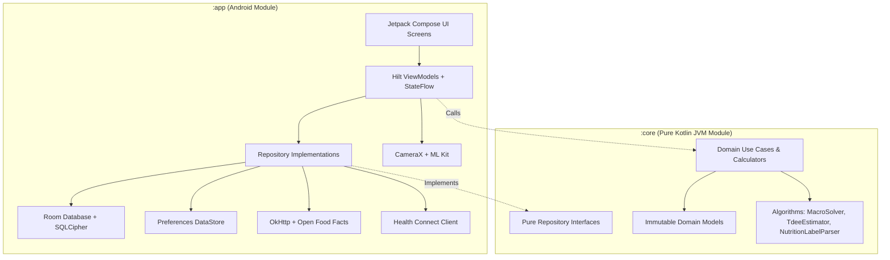
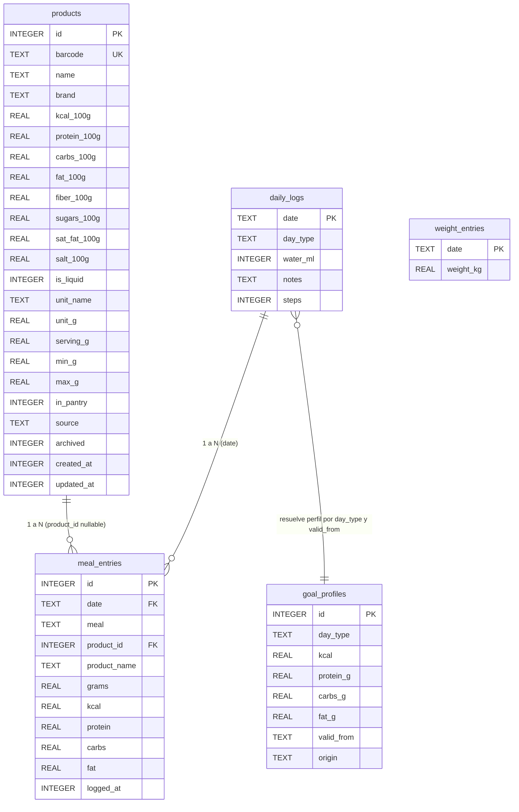

# Visión General del Proyecto — ControlCal (CaloApp)

> **Documento técnico de arquitectura, estado, modelo de datos y roadmap**  
> *Destinado a agentes de IA y desarrolladores de sistemas que no han tenido acceso previo al código fuente.*  
> *Fecha de generación: 10 de noviembre de 2026*  
> *Versión de esquema de base de datos activa: v3*

---

## 1. Resumen Ejecutivo

### 1.1. ¿Qué es ControlCal?
**ControlCal** (identificador de aplicación: `com.controlcal.app`, referenciado en el repositorio como *CaloApp*) es una aplicación móvil nativa para Android enfocada en el control nutricional diario, conteo de calorías y macronutrientes, y seguimiento del peso corporal.

Se diseñó bajo el principio fundamental **local-first**:
1. **Soberanía y privacidad absoluta de datos**: La aplicación funciona al 100 % sin conexión a internet por defecto. Toda la información personal (comidas, alimentos, peso corporal, objetivos y hábitos) se persiste en una base de datos SQLite cifrada mediante **SQLCipher** con una clave criptográfica de 256 bits generada localmente y resguardada por el hardware de **Android Keystore**. No existen servidores propietarios, sincronización forzada en la nube, analíticas de telemetría ni SDKs de rastreo o publicidad.
2. **Instrumento de latencia cero**: Pensado para el uso real en cocina o mesa (pesando alimentos o registrando platos), optimizado para registrar un alimento habitual en **3 toques o menos**.
3. **Rigor e integridad matemática**: Implementa validación energética basada en los factores de Atwater, estimación científica del gasto energético diario (TDEE) mediante media móvil exponencial (EMA), modo tara para restar sobras con garantía de no negatividad en totales, y un optimizador matemático cuadrático multivariable propio (**Macro Tetris**) programado en Kotlin puro para cuadrar macros restantes utilizando alimentos de la despensa.

### 1.2. Audiencia y Perfil de Usuario
Diseñada para un usuario avanzado / uso personal que busca la máxima precisión técnica, densidad de información y control sobre su nutrición, sin fricciones de monetización, registros de cuenta obligatorios ni bases de datos comunitarias saturadas de datos inconsistentes.

### 1.3. Estado Actual del Proyecto (Fases completadas, a medias y pendientes)

El proyecto se desarrolla siguiendo una hoja de ruta estricta descrita en `docs/PLAN.md` y auditada paso a paso en `docs/ESTADO.md`. Todas las tareas de las fases 0 a 5, la fase M (mejoras avanzadas de experiencia de usuario) y la tarea 7.1 están implementadas y verificadas con suites de pruebas unitarias al 100 % en verde.

#### ✅ Qué funciona plenamente (Completado y probado):
- **Cifrado y Persistencia Segura (Fases 1.1 y 1.2)**: SQLite cifrado con SQLCipher 4.19.1 y claves envueltas en AES-GCM por Android Keystore. Aislamiento de clave en `controlcal_key_store`. Migraciones de esquema numeradas y validadas sin borrado destructivo (`MIGRATION_1_2` y `MIGRATION_2_3`).
- **Panel Diario (Fases 1.4, 4.1, 4.3, M.1, M.3, M.4, M.10, 7.1)**:
  - Navegador de fechas con deslizamiento horizontal, calendario interactivo (`DatePickerDialog`) y botón de un toque para volver a «Hoy».
  - Anillo de progreso calórico (`CircularProgressIndicator`) y barras de macronutrientes restantes frente al perfil de objetivos vigente.
  - Selector de tipo de día (*Entrenamiento* vs. *Descanso*).
  - Tarjetas dinámicas por comida con resumen de alimentos, kcal, hora y botón rápido `[+]`.
  - Tarjeta de hidratación (`WaterIntakeCard`) con registro de agua en pasos de 250 ml.
  - Tarjeta de pasos (`StepsCard`) con lectura automática del día anterior vía Health Connect y diálogo para edición manual validada.
  - Tarjeta semanal de propuesta de TDEE explicable y chips de sugerencias rápidas ponderadas por franja horaria.
- **Detalle de Comida y Gestión de Entradas (Fases M.4, M.5, 1.7)**:
  - Pantalla estilo *Samsung Health* con conmutador desplegable entre comidas sin cambiar de pantalla.
  - Selector de hora de comida con `TimePicker` de Material 3 y sincronización unificada de `logged_at`.
  - Botones de incremento/decremento rápido `[-]` y `[+]` por alimento con reescalado proporcional que preserva el historial nutricional.
  - Modo tara («Restar sobras»): genera entradas negativas del alimento que restan del total sin permitir que el día o la comida bajen de cero.
  - Acciones «Repetir comida» y «Copiar día de ayer» conservando horas locales exactas.
- **Buscador y Alta de Entradas (Fases 1.6, M.7, M.8, M.9, M.10)**:
  - Buscador local ultrarrápido con normalización de texto (`TextNormalizer`, ignorando mayúsculas y diacríticos) buscando por nombre, marca o código de barras sobre todas las fuentes (MANUAL, OFF, OCR).
  - Consulta manual voluntaria a Open Food Facts con limitador de tasa de 10 peticiones/minuto en ventana móvil.
  - Fusión automática de porciones (`MealEntryMerger`): si se añade un alimento ya presente en la comida y día, se acumulan sus gramos y macros en una única entrada con opción de «Deshacer» en Snackbar.
- **Calorías Rápidas (Fase M.6)**: Registro calórico y de macronutrientes directos sin producto asociado (`product_id = null`), admitido por la migración de Room v2 y validado con Atwater.
- **Escáner de Códigos de Barras (Fases 2.1 a 2.5)**: CameraX + ML Kit Barcode Scanning con compuerta de doble lectura consecutiva (`BarcodeConsecutiveGate`), vibración háptica de 50 ms, búsqueda local instantánea con tarjeta flotante (`LocalProductCard`), consulta remota a Open Food Facts y pantalla obligatoria de confirmación previa a guardar.
- **OCR de Tablas Nutricionales (Fases 3.1 a 3.4)**: Captura en alta resolución con CameraX, reconocimiento offline mediante ML Kit Text Recognition (modelo latino), parser de solapamiento vertical (`NutritionLabelParser`) y validación de 6 reglas de integridad Atwater (`LabelValidator`).
- **Alta y Edición Manual de Productos (Fase 1.5 y revisión general)**: Formulario completo en `ProductConfirmationScreen` para crear alimentos desde cero (`source = ProductSource.MANUAL`), editar productos existentes o archivarlos/eliminarlos de forma segura.
- **Macro Tetris Solver (Fases 5.1 a 5.3)**:
  - Gestión de despensa (`PantryScreen`) con filtros, marcas de disponibilidad en casa, límites mínimos/máximos y unidades personalizadas (ej. «1 huevo = 55 g»).
  - Algoritmo de optimización cuadrática acotada en Kotlin puro (`MacroSolver`) resuelto mediante *Gauss-Seidel Coordinate Descent* en menos de 10 ms para 30 productos.
  - Pantalla interactiva (`MacroTetrisScreen`) con exclusión y reincorporación de ingredientes, reporte de desvío real por macro, sugerencias explicables si el error supera el 10 % e inserción en bloque al diario.
- **Historial y Gráfica de Peso (Fases 4.2 y 4.4)**:
  - Registro de peso con chips rápidos (±0,1 y ±0,5 kg), historial editable con calendario y control de colisiones por fecha.
  - Gráfico interactivo dibujado 100 % en `Canvas` de Compose con curva de tendencia (EMA $\alpha = 0,1$), marcadores, cuadrícula formateada y cursor táctil (*scrubber*) con tooltip y soporte TalkBack.
  - Estimador de TDEE semanal con ventana móvil de 21 días, requisitos estrictos de consistencia (al menos 14 días con comida y 8 pesajes), límite de variación semanal de $\pm 150$ kcal y suelo mínimo de seguridad configurado por el usuario.
- **Ajustes y Objetivos Cíclicos (Fases 1.8, 4.3, M.2, M.3)**:
  - Gestión de comidas personalizadas en DataStore (añadir, renombrar, cambiar hora, desactivar sin perder entradas históricas).
  - Patrón semanal habitual de 7 días (días de entrenamiento vs. descanso).
  - Objetivos de macros diferenciados por tipo de día con versionado histórico (`valid_from`).
- **Sistema de Respuesta y Accesibilidad (Fase M.10 y revisiones de diseño)**:
  - Canal desacoplado de eventos únicos `UiFeedbackEvent` (éxito, error, deshacer, vibración háptica) con `HandleFeedbackEvents`.
  - Respeto a los estándares de diseño Material 3, insets de teclado (`imePadding`), áreas táctiles $\ge 48\text{ dp}$ y soporte de TalkBack.

#### 🟡 Qué está a medias o en desarrollo:
- **Health Connect (Fase 7.1 parcial)**: Actualmente implementada la **lectura exclusiva de pasos agregados** (`StepsRecord.COUNT_TOTAL`). La escritura de nutrición (`NutritionRecord`) e hidratación (`HydrationRecord`) está planificada pero detenida intencionalmente para evitar colisiones con las entradas negativas del modo tara (las cuales lanzan `IllegalArgumentException` en el SDK de Health Connect si no se agregan a nivel de comida o se transforman antes de sincronizar).

#### ❌ Qué está pendiente (Fases futuras de `docs/PLAN.md`):
- **Fase 6 — Chef Local (LLM on-device)**:
  - `6.1`: Informe comparativo de 3 modelos pequeños en hardware real (Gemma .litertlm).
  - `6.2`: `ModelDownloader` con descarga reanudable, sólo Wi-Fi y verificación hash SHA-256.
  - `6.3`: `RecipeEngine` con LiteRT-LM (API Kotlin), streaming, prompt cerrado a ingredientes del solver y liberación de memoria.
  - `6.4`: Plan B con motor de plantillas deterministas por tipo de plato.
- **Fase 7.2 — Copia de Seguridad Cifrada**:
  - Exportación e importación de un único archivo JSON cifrado con AES-256-GCM derivado de contraseña (PBKDF2/Argon2) a través del selector de archivos del sistema. Faltan métodos de lectura y restauración transaccional masiva en repositorios y DAOs.
- **Fase 7.3 — Rendimiento y Adaptabilidad Avanzada**:
  - Generación de *Baseline Profiles* para optimizar el tiempo de arranque en frío.
  - Soporte de clases de tamaño de ventana (`WindowSizeClass`) para tablets y pantallas plegables.
- **Fase 8 — Publicación en Play Store**:
  - Firma con clave de release, activación de R8, auditoría del formulario de seguridad de datos de Google Play y redacción de la política de privacidad.

---

## 2. Stack Técnico

### 2.1. Plataforma de Destino y Herramientas de Compilación
- **Lenguaje**: Kotlin `2.4.20` (compatibilidad de bytecode fijada a JVM 11 tanto en `:app` como en `:core`).
- **Plataforma de destino**: Android nativo.
  - `minSdk`: `28` (Android 9.0 Pie). Permite bloqueo estricto de tráfico HTTP en claro a nivel de plataforma.
  - `targetSdk`: `36` (Android 16).
  - `compileSdk`: `37.2` (Android 17 / API 37 con nivel menor de API 2).
- **Herramientas de construcción**:
  - Gradle Wrapper: `9.8.0`.
  - Android Gradle Plugin (AGP): `9.2.1`.
  - Kotlin Symbol Processing (KSP): `2.3.12`.
  - Gradle Version Catalog centralizado en `gradle/libs.versions.toml`.

### 2.2. Librerías y Dependencias Clave

| Módulo / Librería | Versión | Rol y Propósito en el Proyecto |
| :--- | :--- | :--- |
| **Jetpack Compose BOM** | `2026.09.00` | Define las versiones alineadas del kit de herramientas de UI declarativa moderna de Android. |
| **Material 3 (`material3`)** | *(BOM)* | Sistema de diseño de interfaces: temas claro/oscuro, tipografía dinámica, `TopAppBar`, diálogos, chips y selectores de tiempo. |
| **Compose UI & Graphics** | *(BOM)* | Renderizado de componentes en pantalla y dibujo de alto rendimiento en bajo nivel (`Canvas` en `WeightTrendChart.kt`). |
| **Activity Compose** | `1.13.0` | Integración de Jetpack Compose con el ciclo de vida del Activity (`setContent`, `enableEdgeToEdge`, `BackHandler`). |
| **Lifecycle Runtime KTX** | `2.11.0` | Gestión de estados de ciclo de vida, `ViewModel`, `viewModelScope` y operadores reactivos con corrutinas. |
| **Dagger Hilt** | `2.60.1` | Inyección de dependencias en tiempo de compilación para Android (`@AndroidEntryPoint`, `@HiltViewModel`, `@Singleton`). |
| **Room Database** | `2.8.5` | Abstracción de persistencia relacional (`room-runtime`, `room-ktx`, `room-compiler`). Exporta esquemas JSON en tiempo de compilación. |
| **SQLCipher Android** | `4.19.1` | Motor de base de datos cifrado (`net.zetetic:sqlcipher-android`) que cifra páginas SQLite en disco con AES-256. |
| **AndroidX SQLite** | `2.7.1` | Abstracción de bajo nivel (`SQLiteDriver`, `SQLiteConnection`) para transacciones directas sobre SQLCipher. |
| **Jetpack DataStore Preferences** | `1.2.1` | Almacenamiento clave-valor asíncrono para preferencias de usuario (`controlcal_preferences`) y clave envuelta (`controlcal_key_store`). |
| **CameraX** | `1.6.2` | Control de hardware de cámara (`camera-core`, `camera-camera2`, `camera-lifecycle`, `camera-view`) para vista previa y captura. |
| **ML Kit Barcode Scanning** | `17.3.0` | Detección de códigos de barras (EAN-13, EAN-8, UPC-A, UPC-E) con modelo empaquetado (100 % offline, sin Google Play Services). |
| **ML Kit Text Recognition** | `16.0.1` | OCR de caracteres latinos empaquetado (100 % offline) para lectura de tablas de información nutricional. |
| **OkHttp** | `4.12.0` | Cliente HTTP para llamadas seguras hacia la API REST de Open Food Facts. |
| **kotlinx.serialization** | `1.11.0` | Serialización JSON multiplataforma para respuestas de red (OFF), serialización de comidas en DataStore y fixtures de test. |
| **Health Connect Client** | `1.1.0` | Integración con el framework de salud de Android (`androidx.health.connect:connect-client`) para lectura agregada de pasos. |
| **Robolectric** | `4.17` | Entorno de simulación de Android en la JVM para ejecutar pruebas de Room, DAOs, migraciones y DataStore a máxima velocidad. |
| **Kotlin Coroutines Test** | `1.11.0` | Control de tiempo virtual (`runTest`, `StandardTestDispatcher`) para pruebas unitarias de ViewModels y repositorios. |

---

## 3. Estructura del Proyecto

El repositorio se compone de dos módulos principales con responsabilidades desacopladas:

```
CaloApp/
├── .agents/                          # Habilidades y agentes locales de desarrollo
├── .codex/                           # Ganchos de automatización y configuración de herramientas
├── .impeccable/                      # Configuración de auditoría de diseño nativo Android
├── app/                              # MÓDULO ANDROID (:app): UI, hardware, red, persistencia
│   ├── schemas/                      # Esquemas exportados de Room (v1, v2, v3 en JSON)
│   ├── src/
│   │   ├── androidTest/              # Pruebas instrumentadas en hardware (mínimas por diseño)
│   │   ├── debug/                    # Código exclusivo de compilación debug
│   │   │   └── java/.../ui/debug/    # Recolector de etiquetas OCR (OcrCollectorScreen.kt)
│   │   ├── main/
│   │   │   ├── java/com/controlcal/app/
│   │   │   │   ├── camera/           # Integración con CameraX y analizadores
│   │   │   │   │   ├── BarcodeAnalyzer.kt          # Analizador de ImageAnalysis para ML Kit
│   │   │   │   │   ├── BarcodeConsecutiveGate.kt   # Filtro de 2 lecturas consecutivas idénticas
│   │   │   │   │   ├── CameraPreview.kt            # Vista previa Compose de CameraX
│   │   │   │   │   └── VibrationHelper.kt          # Emisión de respuesta háptica (50 ms)
│   │   │   │   ├── data/
│   │   │   │   │   ├── db/           # Capa de base de datos Room y SQLCipher
│   │   │   │   │   │   ├── dao/      # Data Access Objects (DailyLogDao, MealEntryDao, etc.)
│   │   │   │   │   │   ├── entity/   # Entidades relacionales Room (@Entity)
│   │   │   │   │   │   ├── ControlCalDatabase.kt         # Definición abstracta de la base de datos
│   │   │   │   │   │   ├── ControlCalDatabaseProvider.kt # Apertura y configuración de SQLCipherDriver
│   │   │   │   │   │   └── Migrations.kt                 # Migraciones de esquema MIGRATION_1_2 y 2_3
│   │   │   │   │   ├── health/       # HealthConnectManagerImpl (lectura agregada de pasos)
│   │   │   │   │   ├── off/          # Cliente HTTPS para Open Food Facts (OffClient, OffMapper, OffRateLimiter)
│   │   │   │   │   ├── repo/         # Implementaciones de repositorios definidas en :core
│   │   │   │   │   └── security/     # Seguridad: Android Keystore, cifrado AES-GCM y resolución de claves
│   │   │   │   ├── di/               # Módulos de inyección de dependencias de Hilt
│   │   │   │   ├── ui/               # Pantallas en Jetpack Compose, ViewModels y estados UI
│   │   │   │   │   ├── about/        # Pantalla Acerca de y atribución legal ODbL
│   │   │   │   │   ├── confirm/      # Pantalla de confirmación/edición/alta manual de producto
│   │   │   │   │   ├── detail/       # Detalle de comida estilo Samsung Health
│   │   │   │   │   ├── entry/        # Buscador y alta rápida de alimentos en el diario
│   │   │   │   │   ├── feedback/     # Sistema centralizado UiFeedbackEvent y UiText
│   │   │   │   │   ├── ocr/          # Captura guiada de fotos de tablas nutricionales
│   │   │   │   │   ├── panel/        # Panel principal del diario, anillo calórico y tarjetas
│   │   │   │   │   ├── pantry/       # Gestión de despensa y límites de alimentos
│   │   │   │   │   ├── scanner/      # Escáner de código de barras
│   │   │   │   │   ├── settings/     # Configuración de comidas, patrón semanal y objetivos
│   │   │   │   │   ├── tetris/       # Pantalla de optimización Macro Tetris
│   │   │   │   │   ├── theme/        # Tema Material 3, colores de marca, tipografía y formas
│   │   │   │   │   └── weight/       # Registro de peso y gráfico interactivo en Canvas
│   │   │   │   ├── ControlCalApplication.kt # Punto de entrada de la aplicación Hilt
│   │   │   │   ├── MainActivity.kt          # Actividad única del proyecto y enrutador
│   │   │   │   └── MainNavigationState.kt   # Gestor de pila de navegación persistente
│   │   │   └── res/                  # Recursos nativos (iconos vectoriales, strings en español, esquemas XML)
│   │   └── test/                     # Pruebas unitarias de :app con Robolectric y JUnit 4
│   ├── build.gradle.kts              # Configuración de compilación del módulo :app
│   └── proguard-rules.pro            # Reglas de ofuscación R8
│
├── core/                             # MÓDULO JVM PURO (:core): Reglas de negocio y algoritmos
│   ├── src/
│   │   ├── main/kotlin/com/controlcal/core/
│   │   │   ├── date/                 # Conversión horaria UTC <-> local y utilidades de fecha
│   │   │   ├── health/               # Validadores puros de pasos (StepsValidator)
│   │   │   ├── meal/                 # Casos de uso de configuración de comidas
│   │   │   ├── model/                # Modelos de dominio inmutables (Product, MealEntry, GoalProfile, etc.)
│   │   │   ├── nutrition/            # Cálculos de totales, restante, fusiones y formateadores
│   │   │   ├── ocr/                  # Parser nutricional Atwater y validador de etiquetas
│   │   │   ├── pantry/               # Validadores de límites de porción de despensa
│   │   │   ├── repo/                 # Interfaces puras de repositorio (sin Room ni Android)
│   │   │   ├── search/               # Motor de búsqueda y normalizador diacrítico sin tildes
│   │   │   ├── solver/               # MacroSolver y FoodSelector (optimización matemática)
│   │   │   ├── suggest/              # QuickLogRanker (algoritmo de sugerencias por hora)
│   │   │   ├── tdee/                 # Estimador de TDEE y media móvil exponencial (EMA)
│   │   │   └── weight/               # Validadores puros de pesaje corporal
│   │   └── test/                     # Pruebas unitarias de :core (incluye fixtures reales de OCR)
│   └── build.gradle.kts              # Configuración de compilación del módulo :core (JVM puro)
│
├── docs/                             # Documentación de diseño, auditorías y bitácora
│   ├── ESTADO.md                     # Registro cronológico detallado de tareas y decisiones
│   ├── PLAN.md                       # Especificación técnica completa del producto
│   ├── revision-general.md           # Auditoría profunda de arquitectura y funcionalidad
│   └── revision-seguridad.md         # Auditoría de manifiestos, red y ciclo de claves
│
├── gradle/                           # Catálogo de versiones y wrapper de Gradle
├── AGENTS.md                         # Reglas inmutables del proyecto para asistentes de IA
├── PRODUCT.md                        # Documento de visión de producto y diseño
└── README.md                         # Descripción técnica general del repositorio
```

---

## 4. Arquitectura del Sistema

### 4.1. Separación Estricta de Módulos Gradle
El proyecto impone una frontera arquitectónica infranqueable:
- **Módulo `:core`**: Es una librería Kotlin pura de la JVM. **Tiene terminantemente prohibido importar paquetes `android.*` o `androidx.*`** (Regla 2 de `AGENTS.md`). Contiene toda la lógica algorítmica, fórmulas matemáticas, parsers, validaciones y contratos de interfaces. Cualquier desarrollador o IA puede ejecutar sus pruebas en milisegundos sin emuladores ni dependencias de plataforma.
- **Módulo `:app`**: Módulo de aplicación Android. Implementa las interfaces de `:core` utilizando las APIs del sistema operativo (Room, SQLiteDriver, Keystore, CameraX, ML Kit, Compose, OkHttp).



### 4.2. Patrón de Diseño y Flujo Unidireccional de Datos (UDF)
La interfaz de usuario implementa el patrón **MVVM / UDF**:
1. **Estado Inmutable**: Cada pantalla cuenta con una clase de datos inmutable `UiState` expuesta por el ViewModel mediante `StateFlow<UiState>`.
2. **Consumo Reactivo en Compose**: Los composables leen el estado con `collectAsStateWithLifecycle()`, garantizando que la recolección se pause cuando la aplicación pasa a segundo plano.
3. **Eventos de Acción**: Las interacciones del usuario (pulsaciones, escritura) invocan métodos del ViewModel sin mutar variables locales de la vista.
4. **Eventos de Una Sola Vez (`UiFeedbackEvent`)**: Para evitar el problema clásico de mensajes duplicados al rotar la pantalla o navegar hacia atrás, las notificaciones visuales (Snackbars), vibraciones hápticas y peticiones de cierre de teclado se emiten mediante un canal `Channel<UiFeedbackEvent>(Channel.BUFFERED)` expuesto como `Flow` con `receiveAsFlow()`.

```kotlin
// Fragmento representativo en Base ViewModels (ej. AddEntryViewModel.kt)
private val _feedbackEvents = Channel<UiFeedbackEvent>(Channel.BUFFERED)
val feedbackEvents: Flow<UiFeedbackEvent> = _feedbackEvents.receiveAsFlow()

fun savePortion(...) {
    viewModelScope.launch {
        // Ejecución en hilo de fondo
        val result = repository.save(entry)
        _feedbackEvents.send(UiFeedbackEvent.Success(UiText.StringResource(R.string.item_saved)))
    }
}
```

### 4.3. Navegación en Actividad Única (*Single Activity*)
No se utiliza la librería Navigation Compose con strings serializados en rutas URI para evitar la serialización compleja de tipos de dominio y problemas de recreación de estado. En su lugar, el proyecto implementa un enrutador desacoplado en `MainActivity.kt` gobernado por `MainNavigationState`:
- La pila de pantallas se almacena en memoria y sobrevive a cambios de configuración y recreación del proceso gracias a un `Saver` personalizado (`rememberMainNavigationState()`).
- Al navegar hacia un destino ya existente en la pila, se ejecuta un comportamiento equivalente a *pop-up-to*, evitando pantallas duplicadas.
- Los contextos de fecha y comida (`MealEntryContext(date, mealId)`) se propagan limpiamente entre el diario, el buscador, el escáner y la confirmación de productos.

---

## 5. Catálogo Detallado de Funcionalidades

### 5.1. Panel Diario (`DailyPanelScreen.kt`)
- **Ubicación**: `app/src/main/java/com/controlcal/app/ui/panel/`
- **ViewModel**: `DailyPanelViewModel.kt`
- **Funcionamiento Interno**:
  - Consulta `DailyLogRepository` y `MealEntryRepository` para la fecha activa.
  - Calcula en tiempo real la suma de calorías y macronutrientes consumidos (`NutritionCalculator.calculateDayTotals`).
  - Obtiene el perfil de objetivos vigente para el tipo de día (`GetActiveGoalProfileUseCase`) y calcula el restante o superávit con `CalculateDayRemainingUseCase`.
  - Construye dinámicamente las secciones de comidas (`MealSectionUiModel`): muestra todas las comidas activas ordenadas por su hora de inicio, más cualquier comida desactivada que contenga registros para esa fecha. Si existen entradas huérfanas, las agrupa en la sección especial «Sin asignar».
  - Muestra un anillo calórico circular (`CircularProgressIndicator`) con el desglose de calorías consumidas vs. objetivo.
  - Ofrece el selector de hidratación (`WaterIntakeCard`) para sumar o restar agua en vasos de 250 ml.
  - Presenta la tarjeta de pasos (`StepsCard`), que consulta a `HealthConnectManager` los pasos del día anterior y permite la edición manual validada con `StepsValidator`.
  - Si los datos de los últimos 21 días cumplen con los requisitos de consistencia, despliega la tarjeta de propuesta semanal de TDEE (`WeeklyTdeeProposalCard`).

### 5.2. Detalle de Comida (`MealDetailScreen.kt`)
- **Ubicación**: `app/src/main/java/com/controlcal/app/ui/detail/`
- **ViewModel**: `MealDetailViewModel.kt`
- **Funcionamiento Interno**:
  - Cabecera interactiva con selector desplegable de comidas para alternar entre Desayuno, Almuerzo, Cena, etc., sin recargar la pantalla.
  - Selector de hora de comida con diálogo `TimePicker` de Material 3. Al cambiar la hora, actualiza de forma atómica el campo `logged_at` de todas las entradas de esa comida para esa fecha (`mealEntryDao.updateLoggedAtForMeal`).
  - Cada fila de alimento presenta controles `[-]` y `[+]`. La función matemática `MealPortionCalculator.calculateStep` determina el paso de ajuste (priorizando `unit_g`, luego `serving_g` y por defecto 10 g). Al pulsar, recalcula proporcionalmente las calorías y macronutrientes **sobre los valores ya almacenados en la propia entrada**, protegiendo el registro histórico si el alimento maestro en `products` es modificado posteriormente en la despensa.
  - Opción «Restar sobras» (Modo Tara): abre un diálogo para seleccionar un alimento ya consumido e ingresar los gramos sobrantes; genera una entrada negativa (`grams < 0`) mediante `CreateTareEntryUseCase`.
  - Acciones en barra superior: «Repetir esta comida» y «Copiar el día de ayer» (`RepeatMealUseCase`, `CopyDayUseCase`), trasladando las entradas a la fecha actual manteniendo sus horas locales exactas.

### 5.3. Buscador y Alta de Entradas (`AddEntryScreen.kt`)
- **Ubicación**: `app/src/main/java/com/controlcal/app/ui/entry/`
- **ViewModel**: `AddEntryViewModel.kt`
- **Funcionamiento Interno**:
  - Búsqueda reactiva con `debounce(150L)` ejecutada fuera del hilo principal (`Dispatchers.Default`).
  - Cuando el campo de búsqueda está vacío, `QuickLogRanker.rankHabitualsForMeal` calcula los alimentos más frecuentes de esa comida basándose en un historial de 60 días con decaimiento lineal por antigüedad.
  - Al escribir, `ProductSearchEngine` busca subcadenas en nombre y marca, y prefijos de 8 o más dígitos para códigos de barras. Los diacríticos y mayúsculas se neutralizan con `TextNormalizer`.
  - Al final de la lista, incluye la opción explícita «Buscar en Open Food Facts». Esta acción jamás se dispara automáticamente; requiere pulsación expresa del usuario.
  - Diálogo de cantidad (`PortionQuantityDialog`): permite alternar entre gramos y unidades discretas si el producto define `unit_g`.
  - Al confirmar, `MealEntryRepositoryImpl.save` invoca `MealEntryMerger`. Si el alimento ya existía en esa misma comida y día, suma sus porciones y emite un Snackbar con botón «Deshacer».

### 5.4. Escáner de Códigos de Barras (`ScannerScreen.kt`)
- **Ubicación**: `app/src/main/java/com/controlcal/app/ui/scanner/`
- **ViewModel**: `ScannerViewModel.kt`
- **Funcionamiento Interno**:
  - Control de cámara mediante `CameraPreview` (CameraX) enlazada al ciclo de vida del composable con liberación automática en `DisposableEffect`.
  - La captura de fotogramas (`ImageAnalysis`) utiliza `STRATEGY_KEEP_ONLY_LATEST` y corre en un `ExecutorService` de un solo hilo en segundo plano.
  - Los códigos leídos pasan por `BarcodeConsecutiveGate`: exige recibir el mismo código de barras en dos fotogramas consecutivos antes de dar la lectura por válida, eliminando lecturas espurias.
  - Al validar el código, emite una vibración corta de 50 ms (`VibrationHelper`).
  - Orden estricto de resolución:
    1. Base de datos local: si el producto ya existe en Room, muestra una tarjeta flotante (`LocalProductCard`) para añadirlo al diario con un solo toque sin consumir red.
    2. Red (Open Food Facts): si no está en local, consulta `OffClient.getProductByBarcode`. Si lo encuentra, navega a `ProductConfirmationScreen` con los campos prepoblados.
    3. Si no existe o no hay red, muestra un diálogo ofreciendo alta manual directa o escaneo de tabla nutricional por OCR conservando el código de barras leído.

### 5.5. Captura y Parser de OCR (`OcrCaptureScreen.kt`)
- **Ubicación**: `app/src/main/java/com/controlcal/app/ui/ocr/`
- **ViewModel**: `OcrCaptureViewModel.kt`
- **Funcionamiento Interno**:
  - Muestra una guía de encuadre (*viewfinder*) con control de linterna.
  - Toma una captura de alta resolución con `ImageCapture` de CameraX y la procesa en segundo plano con `TextRecognizer` de ML Kit (modelo latino offline).
  - La salida cruda de ML Kit (bloques, líneas y cajas delimitadoras `Rect`) se transforma en modelos neutros de `:core` (`OcrLine`, `OcrBox`) y se entrega a `NutritionLabelParser`.
  - El parser ejecuta un análisis geométrico:
    1. Normaliza texto numérico corrigiendo confusiones típicas de OCR (ej. confundir 'O' con '0', 'l' con '1', o terminaciones '9' que corresponden a la letra 'g').
    2. Identifica filas mediante palabras clave en español y portugués («valor energético», «grasas», «hidratos de carbono», «proteínas», etc.).
    3. Asocia números a sus etiquetas evaluando el **solapamiento vertical** de las cajas delimitadoras, descartando el orden secuencial del texto plano.
    4. Desambigua columnas buscando encabezados («por 100 g» o «por 100 ml») mediante alineación horizontal de coordenadas X.
    5. Extrae energía en kcal (o convierte desde kJ dividiendo entre 4,184).
  - `LabelValidator` valida 6 reglas nutricionales: balance de Atwater ($4P + 4C + 9G + 2\text{Fibra} \approx \text{kcal} \pm 15\%$), azúcares $\le$ carbohidratos, grasas saturadas $\le$ grasas totales, valores individuales $\le 100\text{ g}$, energía $\le 900\text{ kcal}$ y no negatividad.
  - Los resultados se presentan en `ProductConfirmationScreen` con la foto capturada en miniatura (ampliable a pantalla completa) y los campos dudosos o con baja confianza resaltados en rojo.

### 5.6. Confirmación y Edición de Productos (`ProductConfirmationScreen.kt`)
- **Ubicación**: `app/src/main/java/com/controlcal/app/ui/confirm/`
- **ViewModel**: `ProductConfirmationViewModel.kt`
- **Funcionamiento Interno**:
  - Pantalla pivote que centraliza la entrada de productos desde cualquier origen: escáner de códigos, escaneo OCR, alta manual desde cero o edición de productos existentes de la despensa.
  - Cumple estrictamente la **Regla 5 de `AGENTS.md`**: ningún dato obtenido por cámara, red o IA se guarda en disco sin pasar por esta pantalla de confirmación editable.
  - Permite conmutar la bandera `isLiquid` para adaptar los encabezados a `100 ml` y el volumen a `ml`.
  - Valida duplicados de códigos de barras en tiempo real (`barcodeError`).
  - Ofrece la opción de archivar un producto (si tiene entradas registradas en el diario, preservando la integridad referencial) o eliminarlo definitivamente (si no tiene historial).
  - Si el usuario llegó desde una comida del diario, permite confirmar la cantidad consumida y registrarla directamente al presionar guardar.

### 5.7. Despensa y Optimización Macro Tetris
- **Ubicación**: `app/src/main/java/com/controlcal/app/ui/pantry/` y `app/src/main/java/com/controlcal/app/ui/tetris/`
- **ViewModels**: `PantryViewModel.kt`, `MacroTetrisViewModel.kt`
- **Motores en `:core`**: `MacroSolver.kt`, `FoodSelector.kt`, `MacroRounding.kt`
- **Funcionamiento Interno**:
  - El usuario marca en la despensa qué alimentos tiene disponibles físicamente en su cocina (`in_pantry = true`) y puede personalizar sus límites mínimos y máximos por ingesta.
  - La pantalla Macro Tetris toma los macronutrientes restantes del día (objetivo menos consumido hasta el momento).
  - `FoodSelector` ejecuta una búsqueda voraz hacia adelante (*Forward Greedy Selection*): selecciona iterativamente hasta un máximo de 5 alimentos de la despensa que maximicen la reducción del error cuadrático ponderado.
  - `MacroSolver` formula un problema de programación cuadrática con restricciones de caja ($l_j \le x_j \le u_j$) y lo resuelve mediante el método iterativo de descenso de coordenadas de Gauss-Seidel.
  - `MacroRounding` redondea los gramos continuos a múltiplos prácticos de 5 g (o a unidades enteras si el producto declara `unit_g`, ej. huevos).
  - La interfaz reporta el error absoluto y relativo por cada macronutriente. Si algún macro queda desviado en más de un 10 %, muestra una tarjeta informativa con sugerencias concretas sobre qué tipo de alimento incorporar a la despensa (ej. «Falta proteína baja en grasa»).

### 5.8. Registro de Peso y TDEE Adaptativo
- **Ubicación**: `app/src/main/java/com/controlcal/app/ui/weight/`
- **ViewModel**: `WeightViewModel.kt`
- **Algoritmos en `:core`**: `WeightTrend.kt`, `TdeeEstimator.kt`, `TdeeProposalCalculator.kt`
- **Funcionamiento Interno**:
  - `WeightTrend.calculateTrend`: Aplica una media móvil exponencial (EMA) con coeficiente de suavizado $\alpha = 0,1$ sobre la serie cronológica de pesajes, neutralizando las oscilaciones causadas por retención de líquidos o contenido estomacal:
    $$\text{EMA}_t = \alpha \cdot \text{peso}_t + (1 - \alpha) \cdot \text{EMA}_{t-1}$$
  - `WeightTrendChart`: Gráfico interactivo diseñado a medida con `Canvas` de Compose sin librerías de terceros. Dibuja la cuadrícula, la curva de tendencia con relleno en degradado, los pesajes discretos y un cursor táctil con tooltip que anuncia los valores a lectores de pantalla (TalkBack).
  - `TdeeEstimator`: Evalúa una ventana móvil de 21 días. Exige al menos 14 días con registro completo de comidas y al menos 8 pesajes. Calcula el gasto energético real balanceando la ingesta calórica media con la masa corporal ganada o perdida:
    $$\text{TDEE} = \bar{I} - \left(\frac{\Delta\text{tendencia}_{\text{kg}} \times 7700\text{ kcal/kg}}{21\text{ días}}\right)$$
  - `TdeeProposalCalculator`: Propone semanalmente un nuevo objetivo calórico. La variación está acotada a un máximo de $\pm 150\text{ kcal}$ semanales y jamás desciende del límite de seguridad configurado por el usuario en Ajustes (por defecto 1200 kcal). El ajuste nunca se aplica de forma automática; requiere confirmación explícita del usuario.

### 5.9. Ajustes y Configuración de Comidas (`SettingsScreen.kt`)
- **Ubicación**: `app/src/main/java/com/controlcal/app/ui/settings/`
- **ViewModel**: `SettingsViewModel.kt`
- **Funcionamiento Interno**:
  - Configuración de comidas activas: permite añadir comidas personalizadas, renombrarlas, cambiar su hora de inicio, desactivarlas o eliminarlas. Si una comida ya contiene registros en la base de datos, el sistema bloquea su eliminación física para no invalidar el historial y ofrece desactivarla.
  - Configuración del patrón semanal: asignación de los 7 días de la semana a días de *Entrenamiento* o *Descanso*.
  - Configuración de perfiles de macronutrientes: definición de calorías, proteínas, carbohidratos y grasas para cada tipo de día. Al guardar, crea un nuevo registro en `goal_profiles` con fecha `valid_from = hoy`, garantizando que los cálculos de días pasados sigan consultando los objetivos que estaban vigentes en su respectiva fecha.
  - Ajuste del suelo calórico de seguridad para las sugerencias de TDEE.
  - Interruptor para activar la sincronización con Health Connect con diálogo de consentimiento previo.

---

## 6. Modelo de Datos y Persistencia

### 6.1. Esquema de Base de Datos Relacional (Room v3 sobre SQLCipher)

La base de datos relacional se gestiona en `ControlCalDatabase.kt` (versión actual: **3**). Los esquemas completos se exportan en formato JSON en `app/schemas/com.controlcal.app.data.db.ControlCalDatabase/`.



#### Descripción detallada de tablas y columnas:

1. **`products`** (Catálogo de alimentos locales):
   - `id`: `INTEGER PRIMARY KEY AUTOINCREMENT NOT NULL`.
   - `barcode`: `TEXT NULL`. Restricción de índice único (`index_products_barcode`).
   - `name`: `TEXT NOT NULL`. Con índice para optimizar búsquedas (`index_products_name`).
   - `brand`: `TEXT NULL`.
   - Macros por 100 g (o 100 ml si `is_liquid` es verdadero): `kcal_100g`, `protein_100g`, `carbs_100g`, `fat_100g` (`REAL NOT NULL`).
   - Macros secundarios: `fiber_100g`, `sugars_100g`, `sat_fat_100g`, `salt_100g` (`REAL NULL`).
   - Propiedades de porción: `is_liquid` (`INTEGER NOT NULL`), `unit_name` (`TEXT NULL`), `unit_g` (`REAL NULL`), `serving_g` (`REAL NULL`).
   - Configuración de despensa: `min_g` (`REAL NULL`), `max_g` (`REAL NULL`), `in_pantry` (`INTEGER NOT NULL DEFAULT 0`).
   - Trazabilidad y ciclo de vida: `source` (`TEXT NOT NULL`: `'MANUAL'`, `'OFF'`, `'OCR'`), `archived` (`INTEGER NOT NULL DEFAULT 0`), `created_at` (`INTEGER NOT NULL`), `updated_at` (`INTEGER NOT NULL`).
   - *Regla de integridad*: Un producto con entradas en el diario nunca se borra físicamente; se marca `archived = 1`.

2. **`daily_logs`** (Cabecera diaria):
   - `date`: `TEXT PRIMARY KEY NOT NULL` (formato ISO local `yyyy-MM-dd`).
   - `day_type`: `TEXT NOT NULL` (`'TRAINING'` o `'REST'`).
   - `water_ml`: `INTEGER NOT NULL DEFAULT 0`.
   - `notes`: `TEXT NULL`.
   - `steps`: `INTEGER NOT NULL DEFAULT 0` (añadido en la migración v3 para sincronización de podómetro).

3. **`meal_entries`** (Entradas registradas en el diario):
   - `id`: `INTEGER PRIMARY KEY AUTOINCREMENT NOT NULL`.
   - `date`: `TEXT NOT NULL`. Clave foránea referenciando `daily_logs(date)` con `ON UPDATE NO ACTION ON DELETE NO ACTION`. Con índice `index_meal_entries_date`.
   - `meal`: `TEXT NOT NULL`. Identificador estable de la comida (`'BREAKFAST'`, `'LUNCH'`, `'SNACK'`, `'DINNER'` o UUID).
   - `product_id`: `INTEGER NULL`. Clave foránea referenciando `products(id)` con `ON UPDATE NO ACTION ON DELETE NO ACTION`. Admite valor `NULL` desde la versión 2 (M.6) para representar calorías rápidas. Con índice compuesto `index_meal_entries_product_id_logged_at`.
   - `product_name`: `TEXT NOT NULL`. Copia estática del nombre en el momento del registro.
   - `grams`: `REAL NOT NULL`. Gramos consumidos (puede ser negativo en modo tara; `0.0` en calorías rápidas).
   - `kcal`, `protein`, `carbs`, `fat`: `REAL NOT NULL`. **Copia calculada y congelada** de los macronutrientes en el momento de guardar. *Propósito*: Si el usuario edita posteriormente la ficha del producto en la despensa, el historial nutricional pasado permanece inmutable.
   - `logged_at`: `INTEGER NOT NULL`. Marca de tiempo Unix en milisegundos correspondiente a la hora local calculada.

4. **`weight_entries`** (Historial de pesaje corporal):
   - `date`: `TEXT PRIMARY KEY NOT NULL` (formato ISO local `yyyy-MM-dd`).
   - `weight_kg`: `REAL NOT NULL`.

5. **`goal_profiles`** (Perfiles de macronutrientes):
   - `id`: `INTEGER PRIMARY KEY AUTOINCREMENT NOT NULL`.
   - `day_type`: `TEXT NOT NULL` (`'TRAINING'` o `'REST'`).
   - `kcal`, `protein_g`, `carbs_g`, `fat_g`: `REAL NOT NULL`.
   - `valid_from`: `TEXT NOT NULL` (fecha ISO local a partir de la cual entra en vigor).
   - `origin`: `TEXT NOT NULL` (`'MANUAL'` o `'TDEE'`).

### 6.2. Historial de Migraciones de Room
Prohibido el uso de `fallbackToDestructiveMigration` (Regla 6 de `AGENTS.md`). Cada evolución de esquema cuenta con su migración numerada y prueba unitaria en Robolectric (`ControlCalDatabaseMigrationTest.kt`):
- **`MIGRATION_1_2`**: Hace que `meal_entries.product_id` sea nullable (`INTEGER` en lugar de `INTEGER NOT NULL`) para soportar calorías rápidas sin romper las claves foráneas ni los índices existentes.
- **`MIGRATION_2_3`**: Añade la columna `steps INTEGER NOT NULL DEFAULT 0` a la tabla `daily_logs` para almacenar los pasos diarios sin alterar los registros existentes.

### 6.3. Almacenamiento en DataStore Preferences
Para configuraciones ligeras y desacopladas de la base de datos relacional:
1. **`controlcal_preferences`**:
   - `configured_meals_json`: Lista serializada en JSON de objetos `ConfiguredMeal` (id, nombre, hora de inicio y estado activo).
   - `default_weekly_pattern`: Cadena de 7 caracteres (ej. `"T,T,R,T,T,R,R"`) que codifica el tipo de día habitual para cada día de la semana.
   - `min_kcal_limit`: Umbral calórico mínimo de seguridad (Double, por defecto 1200.0).
   - `last_tdee_proposal_reviewed_date`: Cadena con la fecha de la última propuesta de TDEE aceptada o rechazada.
   - `health_connect_steps_sync_enabled`: Booleano que indica si el usuario activó la lectura de pasos de Health Connect.
2. **`controlcal_key_store`**:
   - Archivo dedicado exclusivamente al resguardo de la clave envuelta (`wrapped_db_key`), separado físicamente de las preferencias de usuario para evitar escrituras frecuentes sobre el archivo que contiene el secreto criptográfico.

---

## 7. Servicios Externos, Red y Permisos

### 7.1. Integración con Open Food Facts (OFF)
- **Cliente centralizado**: `OffClientImpl` (`app/src/main/java/com/controlcal/app/data/off/OffClient.kt`). Cumple la Regla 3 de `AGENTS.md` (único punto de la aplicación que abre sockets HTTP).
- **Protocolo y Endpoints**:
  - Exclusivamente HTTPS forzado.
  - Consulta por código de barras:
    ```http
    GET https://world.openfoodfacts.org/api/v2/product/{barcode}.json?fields=product_name,brands,quantity,serving_size,nutriments
    ```
  - Búsqueda manual por nombre:
    ```http
    GET https://world.openfoodfacts.org/cgi/search.pl?search_terms={query}&search_simple=1&action=process&json=1&page_size=20&fields=code,product_name,brands,nutriments,quantity,serving_size&tagtype_0=countries&tag_contains_0=contains&tag_0=spain
    ```
- **Cabeceras obligatorias**:
  `User-Agent: ControlCal/1.0 (cambiar@gmail.com)` (correo configurable de contacto según los términos de uso de la API de OFF).
- **Protección y Limitación de Tasa**:
  - Timeouts estrictos de 5 segundos para conexión y lectura.
  - `OffRateLimiter`: Implementa una ventana deslizante de 60 segundos en cliente que bloquea cualquier petición que exceda el límite de 10 peticiones por minuto, evitando bloqueos por parte de los servidores de OFF.
  - La búsqueda libre por nombre solo se dispara por pulsación manual expresa del usuario (nunca en tiempo real mientras escribe).

### 7.2. Integración con Health Connect
- **Cliente**: `HealthConnectManagerImpl` (`app/src/main/java/com/controlcal/app/data/health/HealthConnectManager.kt`).
- **Permiso solicitado**: `android.permission.health.READ_STEPS`.
- **Mecanismo de lectura**: Ejecuta `AggregateRequest` con la métrica `StepsRecord.COUNT_TOTAL` entre el inicio y el final de la jornada en la zona horaria del dispositivo, consolidando los pasos registrados por el teléfono y relojes inteligentes conectados (ej. Samsung Galaxy Watch) sin duplicar mediciones.

### 7.3. Seguridad de Red y Permisos de Android (`AndroidManifest.xml`)
- **Permisos declarados**:
  - `android.permission.CAMERA`: Uso del sensor para escaneo de códigos y captura de etiquetas OCR.
  - `android.permission.VIBRATE`: Emisión de retroalimentación háptica corta (50 ms).
  - `android.permission.INTERNET`: Comunicación HTTPS exclusiva con Open Food Facts.
  - `android.permission.health.READ_STEPS`: Lectura de pasos en Health Connect.
- **Eliminación explícita de telemetría y permisos transitivos**:
  Las librerías de ML Kit incluyen por defecto dependencias transitivas de telemetría de Google (`datatransport`). En el manifiesto se neutralizan explícitamente:
  ```xml
  <uses-permission android:name="android.permission.ACCESS_NETWORK_STATE" tools:node="remove" />
  <service android:name="com.google.android.datatransport.runtime.backends.TransportBackendDiscovery" tools:node="remove" />
  <service android:name="com.google.android.datatransport.runtime.scheduling.jobscheduling.JobInfoSchedulerService" tools:node="remove" />
  <receiver android:name="com.google.android.datatransport.runtime.scheduling.jobscheduling.AlarmManagerSchedulerBroadcastReceiver" tools:node="remove" />
  ```
- **Configuración de Seguridad de Red (`network_security_config.xml`)**:
  Bloquea todo el tráfico en texto claro a nivel de sistema operativo y restringe los certificados de confianza únicamente al dominio de Open Food Facts:
  ```xml
  <network-security-config>
      <base-config cleartextTrafficPermitted="false">
          <trust-anchors />
      </base-config>
      <domain-config cleartextTrafficPermitted="false">
          <domain includeSubdomains="true">world.openfoodfacts.org</domain>
          <trust-anchors>
              <certificates src="system" />
          </trust-anchors>
      </domain-config>
  </network-security-config>
  ```
- **Reglas de Respaldo (`backup_rules.xml` y `data_extraction_rules.xml`)**:
  Declaran `android:allowBackup="false"` y excluyen explícitamente todos los dominios (`database`, `sharedpref`, `file`, `root`, `external`) para impedir que copias automáticas en la nube de Google o transferencias entre dispositivos extraigan la base de datos cifrada o las preferencias locales.

---

## 8. Configuración, Compilación y Ejecución

### 8.1. Archivos de Configuración del Proyecto
- `gradle.properties`: Contiene parámetros de memoria de la JVM de Gradle y la directiva `android.suppressUnsupportedCompileSdk=37.2` para permitir la sincronización en versiones de Android Studio que aún no reconocen oficialmente la API 37.2 como estable.
- `local.properties`: Ubicación local del Android SDK (`sdk.dir`). No se comitea al repositorio.
- `gradle/libs.versions.toml`: Catálogo estandarizado de dependencias y plugins.

### 8.2. Variables de Entorno y Secretos
**El proyecto no utiliza claves de API privadas ni archivos `.env`.**  
No existen credenciales de terceros requeridas para compilar o ejecutar la aplicación. La comunicación con Open Food Facts es de acceso público y el modelo de ML Kit está completamente empaquetado en el binario.

### 8.3. Comandos de Compilación y Verificación
Para certificar la integridad del proyecto, se deben ejecutar los siguientes comandos mediante el terminal (PowerShell o Bash):

```bash
# 1. Ejecutar las pruebas unitarias del módulo puro :core
./gradlew :core:test

# 2. Ejecutar las pruebas unitarias y de Robolectric del módulo :app
./gradlew testDebugUnitTest

# 3. Analizar la calidad del código mediante el linter oficial de Android
./gradlew lintDebug

# 4. Compilar el paquete de depuración (APK Debug)
./gradlew assembleDebug

# 5. Instalar directamente en un dispositivo físico conectado vía ADB
./gradlew installDebug
```

---

## 9. Análisis de Calidad, Robustez y Deuda Técnica

### 9.1. Cobertura de Pruebas Automatizadas
El repositorio cuenta con una cobertura de pruebas exhaustiva ejecutada en tiempo de compilación sobre la JVM:
- **Pruebas en `:core` (33 suites de test)**: Pruebas unitarias puras que cubren todas las ramas del optimizador Macro Tetris (`MacroTetrisTest.kt`), las fórmulas de Atwater (`LabelValidatorTest.kt`), la integridad y parametrización del parser OCR con 19 fixtures reales (`NutritionLabelParserParameterizedTest.kt`), el cálculo de tendencias EMA (`WeightTrendTest.kt`), el estimador de TDEE ante múltiples escenarios de variabilidad (`TdeeEstimatorTest.kt`), el algoritmo de sugerencias horarias (`QuickLogRankerTest.kt`), la normalización diacrítica de texto (`TextNormalizerTest.kt`) y la fusión de entradas (`MealEntryMergerTest.kt`).
- **Pruebas en `:app` (34 suites de test con Robolectric)**: Verificación de operaciones de base de datos en memoria para todos los DAOs (`ProductDaoTest`, `MealEntryDaoTest`, `DailyLogDaoTest`, etc.), pruebas de migración de esquema v1 $\rightarrow$ v2 y v2 $\rightarrow$ v3 con `room-testing` (`ControlCalDatabaseMigrationTest.kt`), pruebas de serialización y recuperación ante JSON corrupto en DataStore (`MealConfigRepositoryImplTest.kt`), pruebas de envoltura de claves con fakes criptográficos (`DatabaseKeyResolverTest.kt`), y pruebas de flujo reactivo de los 10 ViewModels con `kotlinx-coroutines-test`.

### 9.2. Deuda Técnica y Puntos de Fragilidad Detectados

1. **Ciclo de Vida de los ViewModels en `MainActivity`**:
   - *Situación*: En `MainActivity.kt`, los 10 ViewModels se instancian a nivel de Activity mediante el delegado `by viewModels()`.
   - *Impacto*: Como la aplicación navega alternando la variable de estado `currentDestination` sin destruir el Activity, el método `onCleared()` de los ViewModels nunca se invoca mientras la aplicación esté en memoria.
   - *Consecuencia para la Fase 6*: En la futura integración del Chef Local (LLM on-device), el modelo Gemma (`.litertlm`) consume cientos de megabytes de RAM. No puede mantenerse vivo en un ViewModel atado indefinidamente al Activity. Requerirá un ciclo de vida con liberación forzada al abandonar la pantalla (`onDispose`) o gestión de memoria con `ComponentCallbacks2.onTrimMemory`.

2. **Sincronización Bidireccional de Health Connect (Modo Tara vs. SDK)**:
   - *Situación*: En ControlCal, «Restar sobras» genera entradas con gramos negativos (`grams < 0`) y calorías negativas.
   - *Impacto*: La API oficial de Health Connect (`NutritionRecord`) rechaza valores de energía o masa negativos lanzando `IllegalArgumentException`.
   - *Solución requerida antes de activar escritura*: La capa de sincronización de Health Connect debe consolidar los alimentos a nivel de comida neta antes de sincronizar o calcular la porción resultante de la suma para enviar únicamente registros estrictamente positivos.

3. **User-Agent Provisional de Open Food Facts**:
   - En `OffClient.kt`, la cabecera utiliza `cambiar@gmail.com`. Debería exponerse un campo opcional en Ajustes para que el usuario pueda personalizar su correo de contacto de forma privada.

4. **Herramientas de Análisis Estático (Linter)**:
   - El proyecto utiliza `lintDebug` de Android Gradle Plugin. Aunque no hay dependencias externas de `ktlint` o `detekt` configuradas en el archivo raíz, el análisis estático oficial de Android se encuentra completamente limpio y sin errores bloqueantes.

---

## 10. Convenciones de Código y Patrones de Diseño

1. **Idioma y Localización (Regla 7 de `AGENTS.md`)**:
   - Todo el código fuente, nombres de variables, funciones, clases, comentarios internos, nombres de ramas y mensajes de commit se escriben estrictamente en **inglés**.
   - Todos los textos visibles para el usuario en la interfaz, títulos, botones, mensajes de error y diálogos se redactan en **español** y residen exclusivamente en `app/src/main/res/values/strings.xml`.
   - **Formato numérico**: Los números decimales se formatean obligatoriamente con coma decimal en la interfaz de usuario (ej. `"12,5 g"`) mediante la clase de utilidad pura `NumberFormatHelper`. Los números enteros con miles utilizan punto como separador (ej. `"10.000 pasos"`).
2. **Inmutabilidad y Funciones Puras**:
   - Los modelos de dominio son `data class` inmutables con propiedades `val`. Las transformaciones generan nuevas instancias mediante `.copy()`.
   - La lógica matemática de cálculo nunca muta estructuras existentes.
3. **Mapeo Explícito de Capas**:
   - Las entidades relacionales de Room (`ProductEntity`, `MealEntryEntity`) no se exponen fuera del paquete `data/`. Se convierten a modelos de dominio (`Product`, `MealEntry`) mediante funciones de extensión bidireccionales explícitas (`toDomain()`, `toEntity()`).
4. **Validación Previa en Dominio**:
   - Las reglas de validación (pesajes válidos, objetivos calóricos razonables, límites de despensa, coherencia Atwater) se implementan como validadores puros en `:core` que retornan estructuras selladas con incidencias numéricas. La capa de presentación `:app` las mapea a recursos de texto localizados (`UiText.StringResource`).

---

## 11. Roadmap y Mejoras Propuestas (Ordenadas por Prioridad)

Para la siguiente IA o equipo de desarrollo que proponga mejoras sobre esta base de código, la lista de prioridades técnicas recomendada es:

### Prioridad 1: Arquitectura y Preparación para la Fase 6 (Chef Local)
1. **Gestor de Ciclo de Vida y Memoria para el Motor LLM**:
   - Diseñar una interfaz de motor de inferencia (`LlmInferenceEngine`) con métodos explícitos de ciclo de vida (`loadModel`, `unloadModel`, `generateStreaming`).
   - Implementar liberación inmediata de memoria RAM en el evento `ON_PAUSE` o al salir de la pantalla de recetas, e interceptar advertencias del sistema mediante `ComponentCallbacks2` en `ControlCalApplication`.
2. **`ModelDownloader` con Verificación Hash**:
   - Implementar la descarga en segundo plano con OkHttp del archivo `.litertlm` (desde el host oficial que se apruebe en la configuración de seguridad de red con `REVISION HUMANA`).
   - Soportar pausa, reanudación y comprobación criptográfica estricta de hash SHA-256 antes de dar el archivo por válido.
3. **Plan B con Plantillas Deterministas**:
   - Diseñar el motor de recetas de contingencia (`TemplateRecipeEngine`) para que la pantalla de recetas funcione de forma instantánea sin descargar ningún modelo de IA ni consumir batería adicional.

### Prioridad 2: Respaldo de Datos y Exportación Cifrada (Fase 7.2)
1. **Métodos de Extracción y Restauración Masiva en DAOs**:
   - Incorporar en los repositorios e interfaces de `:core` métodos atómicos para volcar las 5 tablas relacionales a una estructura serializable única y para restaurarlas dentro de una transacción exclusiva `useWriterConnection`.
2. **Cifrado de Archivos de Backup**:
   - Implementar el generador de archivo `.ccbackup` cifrado con AES-256-GCM derivando la clave desde una contraseña introducida por el usuario mediante PBKDF2 (con al menos 100.000 iteraciones) o Argon2.

### Prioridad 3: Accesibilidad y Rendimiento Avanzado (Fase 7.3)
1. **Navegación Táctil Detallada en `WeightTrendChart`**:
   - Ampliar la semántica del `Canvas` de Compose para permitir recorrer mediante gestos de deslizamiento de TalkBack cada pesaje individual del historial con su fecha y valor, complementando la descripción global actual.
2. **Generación de Baseline Profiles**:
   - Configurar el módulo de macrobenchmark para precachear el bytecode de Compose y Room, reduciendo el arranque en frío en dispositivos con hardware más modesto por debajo de 1 segundo.

---

> *Este documento refleja con exactitud la totalidad del código, la configuración de dependencias, las pruebas unitarias y las decisiones arquitectónicas del repositorio CaloApp al 10 de noviembre de 2026.*
